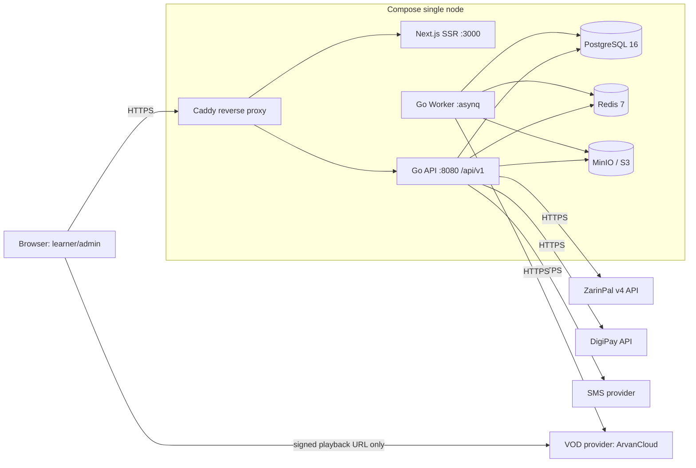

# GoLearn — Architecture (v1 Draft 1)

## 1. Stack & rationale

| Layer | Choice | Why (and what was rejected) |
|-------|--------|------------------------------|
| Backend | **Go 1.24+, chi router** | Explicit, fast, stdlib-idiomatic; chi = thin router + middleware ecosystem. Rejected: Echo/Gin (no functional gain), heavy DI frameworks (manual wiring is clearer at this scale). |
| Data access | **pgx/v5 + sqlc** over **PostgreSQL 16** | Compile-time-checked SQL, no ORM magic; money/decimal and JSONB handled explicitly. Rejected: GORM (reflection, hidden queries). |
| Migrations | **golang-migrate** | SQL up/down files, CI-checkable. |
| Cache/queue | **Redis 7 + asynq** | Mature Go background jobs (ingest polling, reconciliation, expiry sweep) with retries/scheduling. Rejected: cron-in-process (fragile), River (Postgres-based is fine but asynq is battle-tested and we already run Redis). |
| Auth | **JWT access (15 min) + rotating refresh (30 d)**, Argon2id | Matches requirement "JWT + refresh strategy"; refresh rotation gives revocability JWTs lack; denylist in Redis for logout/compromise. |
| Object storage | **S3-compatible** (MinIO in dev; provider S3 e.g. Arvan in prod) | One `Storage` interface; hosting undecided → no hard vendor dependency. |
| Video | **Managed VOD behind `VideoPlatform` adapter** (ArvanCloud target) | Owner decision; local/dev adapter serves HLS fixtures from MinIO with our own HMAC signing so the whole stack runs without the vendor. |
| Payments | **`PaymentGateway` adapter registry**: ZarinPal (official v4 spec), DigiPay (placeholder mapping), Mock | New gateways = one adapter file + config; checkout logic never changes. |
| Frontend | **Next.js 15 (App Router), TypeScript strict**, managed with **Bun** (`bun install`, `bun run`, bun lockfile committed) | RSC/ISR for SEO; server components keep API traffic and secrets off the client. Bun chosen by owner as the JS package manager/runtime. |
| Styling | **Tailwind CSS v4 + Material 3 tokens (CSS custom properties)**, Vazirmatn (self-hosted via `next/font/local`) | M3 token system per the material-3 skill; Apple-style motion per apple-design/animate skills (damped springs, interruptible transitions, `prefers-reduced-motion`). |
| Player | **hls.js** (native HLS fallback on Safari) | Industry standard for VOD HLS. |
| Dates/i18n | `date-fns-jalali`, Persian digits formatter | Jalali display, UTC storage. |
| API contract | **OpenAPI 3.1 first** → `openapi-typescript` for frontend types | Single source of truth shared by both stacks. |
| Proxy | **Caddy** (compose) | Automatic HTTPS, simple config; swap for Nginx if the host requires. |
| CI | GitHub Actions: lint → test → build → e2e smoke | See docs/09. |

Design-skill mapping: `material-3` → tokens/theming; `apple-design` → motion/materials/typography rules; `animate` → animation build discipline; `ponytail` → minimal-change working style; `unslop` → blog prose quality; `kun` → not applicable to architecture.

## 2. Container diagram



Trust boundaries: browser↔proxy (public), proxy↔API (internal), API↔external providers
(credential-authenticated), browser↔VOD (short-lived signed tokens only — **no storage
credentials ever reach the browser**).

## 3. Monorepo layout

```
golearn/
├── docs/                        # this package + ADRs (docs/adr/)
├── backend/
│   ├── cmd/
│   │   ├── api/main.go          # HTTP server wiring
│   │   └── worker/main.go       # asynq worker wiring
│   ├── internal/
│   │   ├── domain/              # entities, value objects, pure logic (imports nothing internal)
│   │   │   ├── identity/        # user, role, session, otp
│   │   │   ├── course/          # course, section, lesson, review
│   │   │   ├── commerce/        # order, payment, coupon, refund, entitlement
│   │   │   ├── learning/        # progress, playback sessions
│   │   │   └── content/         # post, page, testimonial, faq, settings
│   │   ├── service/             # use-cases orchestrating domain + ports
│   │   ├── ports/               # interfaces: PaymentGateway, VideoPlatform, Storage, SMS, Cache, Repos
│   │   ├── adapter/
│   │   │   ├── payment/{zarinpal,digipay,snappay,mock}
│   │   │   ├── video/{arvanvod,local}
│   │   │   ├── storage/s3       # MinIO/Arvan-S3 via S3 API
│   │   │   └── sms/{kavenegar,mock}
│   │   ├── repository/          # pgx implementations (+ sqlc generated)
│   │   ├── transport/http/      # chi handlers, middleware (auth, rbac, csrf, ratelimit, audit), dto
│   │   ├── worker/              # asynq tasks: ingest-poll, reconcile, expire-orders, backups
│   │   └── platform/            # config (env), logger (slog), db pool, redis, httpserver, validator
│   ├── migrations/              # golang-migrate SQL up/down
│   ├── queries/                 # sqlc sources
│   ├── test/                    # integration/e2e helpers, fixtures, mock gateway server
│   ├── openapi.yaml → docs/api/openapi.yaml (single source)
│   └── Makefile                 # dev, migrate, sqlc, test, lint, seed
├── frontend/
│   ├── app/
│   │   ├── (public)/            # home, courses/[slug], blog/[slug], about, contact, faq  (ISR)
│   │   ├── (auth)/login|register|forgot
│   │   ├── (user)/dashboard/    # my courses, player, orders, profile  (SSR dynamic)
│   │   ├── (admin)/admin/       # dashboard, courses, media, orders, users, blog, settings (SSR dynamic)
│   │   ├── sitemap.ts, robots.ts, manifest.ts
│   ├── components/{ui,course,blog,player,admin,seo}
│   ├── lib/{api-client,auth,seo,format(fa digits/toman/jalali),tokens.css}
│   └── messages/                # fa dictionary (single locale, future-proofed)
├── deploy/
│   ├── docker-compose.yml       # api, worker, web, postgres, redis, minio, caddy
│   ├── docker-compose.prod.yml, Caddyfile
├── .env.example, Makefile, README.md
```

## 4. Key decisions (ADR-lite)

| # | Decision | Alternatives | Rationale |
|---|----------|--------------|-----------|
| ADR-1 | Opaque-ish JWT access + rotating refresh in cookies | Opaque DB sessions; long-lived JWT | Requirement names JWT+refresh; rotation + reuse detection ≈ revocable sessions; no server lookup per request |
| ADR-2 | Money = BIGINT Rials everywhere; UI converts to Toman | floats; Toman storage | Gateways denominate in Rials (ZarinPal v4 default IRR); integers only; conversion at the edge |
| ADR-3 | Direct single-course checkout in v1 (schema supports multi-item) | Full cart | Simpler UX + fewer failure modes; `order_items` table already supports carts |
| ADR-4 | Managed VOD behind `VideoPlatform` port; local adapter for dev/tests | Self-hosted ffmpeg | Owner choice; local adapter keeps e2e tests vendor-free |
| ADR-5 | ZarinPal built on official v4 REST spec (documented); DigiPay behind same port with placeholder mapping until docs arrive | Waiting for DigiPay docs | Checkout ships; adapter swap is a contained change |
| ADR-6 | Admin panel lives in the same Next app (`/admin` route group, separate layout + RBAC middleware) | Separate admin SPA | One deploy, shared components; admin pages are all dynamic SSR (no ISR) |
| ADR-7 | Persian-only v1 with a thin dictionary layer (`messages/fa`) | next-intl full i18n | KISS; structure ready if English needed later |
| ADR-8 | SQL-first (sqlc) + explicit transactions for payment paths | ORM | Payment correctness demands visible SQL and locking (`SELECT … FOR UPDATE`) |

## 5. Rendering strategy (SEO-critical routes)

| Route | Strategy | Revalidation |
|-------|----------|--------------|
| `/` home | ISR | 300 s + on-demand on course publish |
| `/courses`, `/courses/[slug]` | ISR | 600 s + on-demand via admin publish webhook (`revalidate` API, secret-protected) |
| `/blog`, `/blog/[slug]` | ISR | 600 s + on-demand on publish |
| `/about`, `/contact`, `/faq` | Static / ISR | content-edit driven |
| `/dashboard/**`, `/admin/**`, `/checkout/**` | SSR, `no-store` | auth-gated, never cached |
| `sitemap.xml` | dynamic route | daily + on publish |

## 6. Configuration & secrets

- All config via env vars, parsed once at boot into a typed `Config` struct; fail-fast on missing values.
- `.env.example` documents every variable; secrets never in git; `.env` git-ignored.
- Groups: `APP_*` (env name, base URL, cookie keys), `POSTGRES_*`, `REDIS_*`, `S3_*`, `JWT_*` (signing key ≥ 32 B entropy), `PAYMENT_ZARINPAL_*` (merchant id, sandbox flag), `PAYMENT_DIGIPAY_*`, `VOD_*`, `SMS_*`, `RATELIMIT_*`.
- Sandbox toggles per external service (payments, SMS, VOD) so dev/test never touch production providers.
- Logs: slog JSON to stdout, request-id + user-id + route fields; **no tokens, no OTP codes, no card data**.

## 7. Cross-cutting request flow (API)

```
request → recover → request-id → real-ip → security headers → rate limit
        → cookie session (JWT parse / refresh hint) → RBAC guard (per route)
        → csrf check (mutations) → validation (dto) → handler → service (tx where needed)
        → response envelope or typed error → audit middleware (sensitive actions) → access log
```

Errors: single envelope `{ "error": { "code": "ORDER_EXPIRED", "message": "…fa…", "details": {} } }` with stable machine codes + Persian user messages; internal errors log server-side and return generic 500s.
