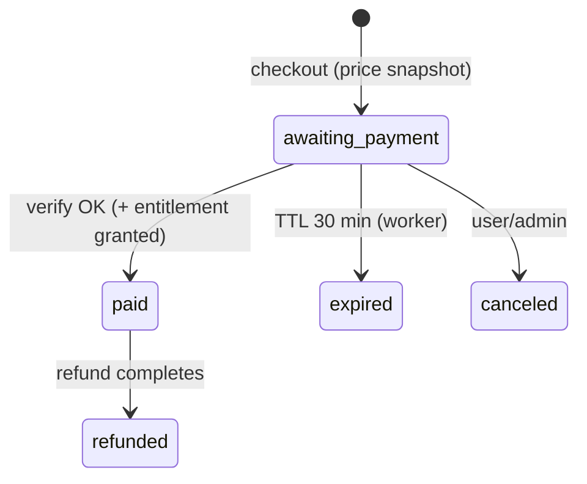
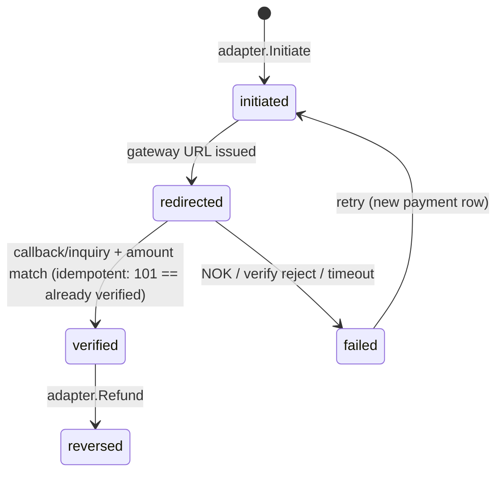
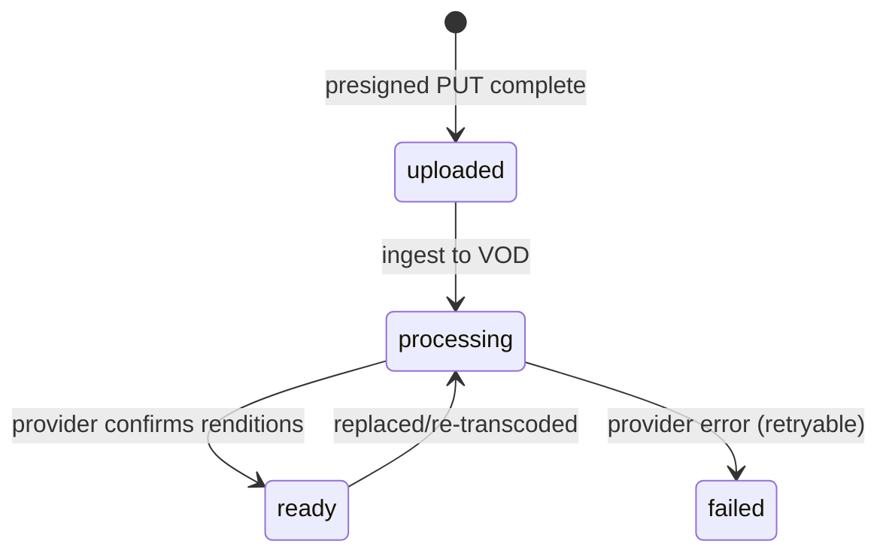

# GoLearn — Domain Model & ERD (v1 Draft 1)

## 1. Bounded contexts

- **identity** — users, roles, sessions, OTP
- **course** — courses, sections, lessons, categories, reviews
- **commerce** — orders, payments, coupons, refunds, entitlements
- **learning** — progress, playback sessions
- **content** — blog, pages, testimonials, FAQ, settings, audit

Contexts communicate through service interfaces; no cross-context SQL joins in
handlers (repositories are context-scoped).

## 2. ERD

```mermaid
erDiagram
    users ||--o{ user_roles : has
    roles ||--o{ user_roles : granted
    users ||--o{ refresh_tokens : owns
    users ||--o{ otp_codes : receives
    users ||--o{ orders : places
    users ||--o{ entitlements : holds
    users ||--o{ lesson_progress : tracks
    users ||--o{ reviews : writes

    instructors ||--o{ courses : teaches
    courses ||--o{ course_sections : contains
    courses ||--o{ course_categories_tagged : ""
    course_categories ||--o{ course_categories_tagged : ""
    course_sections ||--o{ lessons : contains
    lessons ||--o| media_assets : "primary video"
    lessons ||--o{ lesson_attachments : ""
    media_assets ||--o{ lesson_attachments : "file"
    courses ||--o{ reviews : receives
    courses ||--o{ entitlements : "grants access to"
    courses ||--o{ order_items : ""

    orders ||--o{ order_items : contains
    orders ||--o{ payments : "paid via"
    orders ||--o| coupons : "discounted by"
    coupons ||--o{ coupon_redemptions : ""
    users ||--o{ coupon_redemptions : ""
    payments ||--o{ payment_events : logs
    payments ||--o{ refunds : "may be refunded"

    blog_posts }o--|| blog_categories : belongs
    blog_posts ||--o{ blog_post_tags : ""
    blog_tags ||--o{ blog_post_tags : ""
    users ||--o{ blog_posts : authors

    admins_action }o--|| users : "actor"
    pages ||--o{} "" : ""
```

*(rendering note: `admins_action` = `audit_logs`; join tables shown for clarity)*

## 3. Entities & key fields

Conventions: `id uuid PK (v7)`, `created_at/updated_at timestamptz`, soft delete only
where stated. Money columns `*_rial BIGINT` (Rials). Enums are Postgres enums.

### identity
- **users**: `mobile varchar(11) UNIQUE`, `email NULL UNIQUE`, `full_name`, `password_hash NULL` (Argon2id; null until password set), `status enum(active, blocked, deleted)`, `mobile_verified_at`, `last_login_at`
- **user_roles**: (user_id, role) with role as Postgres enum `user_role` — multi-role ready (refined from a separate roles table during implementation)
- **refresh_tokens**: `user_id`, `token_hash sha256`, `family_id uuid` (rotation family), `expires_at`, `revoked_at NULL`, `replaced_by NULL`, `ip`, `user_agent`
- **otp_codes**: `mobile`, `code_hash`, `purpose enum(verify, login, reset)`, `expires_at (2 min)`, `attempts int (max 5)`, `consumed_at NULL`
- **audit_logs**: `actor_user_id`, `action text`, `entity_type`, `entity_id`, `before jsonb NULL`, `after jsonb NULL`, `ip`, `user_agent`

### course
- **instructors**: `user_id UNIQUE` (v1: one row; multi-instructor later just adds rows) — `headline`, `bio_richtext`, `avatar_media_id`, `socials jsonb`
- **courses**: `slug UNIQUE` (Persian-safe), `instructor_id`, `title`, `summary`, `description_richtext`, `cover_media_id`, `promo_video_media_id NULL`, `level enum(beginner, intermediate, advanced)`, `status enum(draft, published, archived)`, `price_rial`, `compare_at_price_rial NULL` (strike-through), `is_featured`, `prerequisites_richtext`, `outcomes jsonb (list)`, `published_at`, `meta_title`, `meta_description`, `og_image_media_id`, `deleted_at NULL`
- **course_categories**: `slug UNIQUE`, `title`, `position`; **course_categories_tagged**(course_id, category_id)
- **course_sections**: `course_id`, `title`, `position` (unique per course)
- **lessons**: `section_id`, `title`, `content_richtext`, `position`, `is_preview bool`, `duration_seconds`, `status enum(draft, ready, published)`, `media_id NULL`
- **lesson_attachments**: `lesson_id`, `media_id`, `title`, `allow_download bool`
- **media_assets**: `kind enum(video, image, pdf)`, `storage_key` (UUID-path, server-generated), `mime`, `size_bytes`, `checksum_sha256 NULL`, `status enum(uploaded, processing, ready, failed)`, `duration_seconds NULL`, `vod_provider NULL`, `vod_remote_id NULL`, `error_message NULL`, `uploaded_by`
- **reviews**: `course_id`, `user_id`, `rating 1..5`, `body`, `status enum(pending, approved, rejected)`, `approved_at`; `UNIQUE(course_id, user_id)`

### commerce
- **coupons**: `code UNIQUE (normalized)`, `type enum(percent, fixed)`, `value` (percent 0–100 or Rials), `max_uses NULL`, `per_user_limit NULL`, `min_amount_rial NULL`, `starts_at`, `ends_at NULL`, `course_scope NULL` (restrict to one course), `status enum(active, disabled)`
- **coupon_redemptions**: `coupon_id`, `user_id`, `order_id` — per-user cap enforcement
- **orders**: `user_id`, `status enum(awaiting_payment, paid, canceled, expired, refunded)`, `subtotal_rial`, `discount_rial`, `total_rial`, `coupon_id NULL`, `expires_at (created+30 min)`, `paid_at NULL`
- **order_items**: `order_id`, `course_id`, `title_snapshot`, `unit_price_rial` (snapshot)
- **payments**: `order_id`, `gateway enum(zarinpal, digipay, snappay, mock)`, `gateway_ref NULL`, `amount_rial`, `status enum(initiated, redirected, verified, failed, reversed)`, `idempotency_key UNIQUE`, `card_masked NULL`, `verified_at NULL`, `failure_reason NULL`
- **payment_events**: `payment_id`, `type enum(request_sent, request_ok, redirect, callback_received, verify_ok, verify_failed, reverse_requested, reverse_ok, reconciled)`, `payload jsonb` (raw gateway data), — append-only audit of every gateway interaction
- **refunds**: `payment_id`, `amount_rial`, `kind enum(gateway_reverse, manual)`, `reason`, `status enum(requested, completed, failed)`, `gateway_ref NULL`, `acted_by`
- **entitlements**: `user_id`, `course_id`, `source enum(purchase, grant, refund_reversed)`, `granted_at`, `expires_at NULL` (lifetime when NULL), `order_id NULL`, `revoked_at NULL`; `UNIQUE(user_id, course_id)` WHERE revoked_at IS NULL

### learning
- **lesson_progress**: `user_id`, `lesson_id`, `position_seconds`, `completed_at NULL`, `updated_at`; `UNIQUE(user_id, lesson_id)`
- **playback_sessions**: `user_id`, `lesson_id`, `issued_at`, `expires_at`, `ip` — audit + abuse analytics

### content
- **blog_categories**: `slug UNIQUE`, `title`; **blog_tags** same shape; **blog_post_tags**(post_id, tag_id)
- **blog_posts**: `slug UNIQUE`, `author_user_id`, `title`, `excerpt`, `body_richtext`, `cover_media_id`, `category_id`, `status enum(draft, published)`, `published_at`, `reading_minutes`, `meta_title`, `meta_description`, `og_image_media_id`
- **pages**: `slug UNIQUE`, `title`, `body_richtext`, `seo fields`
- **faqs**: `question`, `answer`, `position`, `is_published`
- **testimonials**: `author_name`, `author_role`, `body`, `rating`, `avatar_media_id NULL`, `position`, `is_published`
- **contact_messages**: `name`, `mobile_or_email`, `subject`, `body`, `status enum(new, read, replied)`, `user_id NULL`
- **settings**: `key PK`, `value jsonb` (SEO defaults, socials, enabled gateways, maintenance mode)

## 4. State machines







## 5. Invariants (enforced in services + DB)

1. `order.total_rial = Σ order_items.unit_price_rial − discount_rial`; `discount_rial ≤ subtotal`.
2. Order prices are snapshots — later course price changes never mutate orders.
3. A payment `amount_rial` must equal its order's `total_rial` at initiation **and** be re-checked against the gateway's verified amount before `verified`.
4. Entitlement is granted exactly once per (user, course) — idempotent on payment verify (gateway verify code 101 = success path too).
5. Coupon usage increments atomically with the payment verification transaction (row lock on coupon).
6. A lesson references only `media_assets.status = 'ready'` for publish; publish requires course price ≥ 0 and slug unique.
7. Playback issuance requires: active entitlement (or `is_preview`), non-expired user, `ready` media.
8. Every admin mutation on users/courses/orders/payments/coupons/settings writes an audit row in the same transaction.
