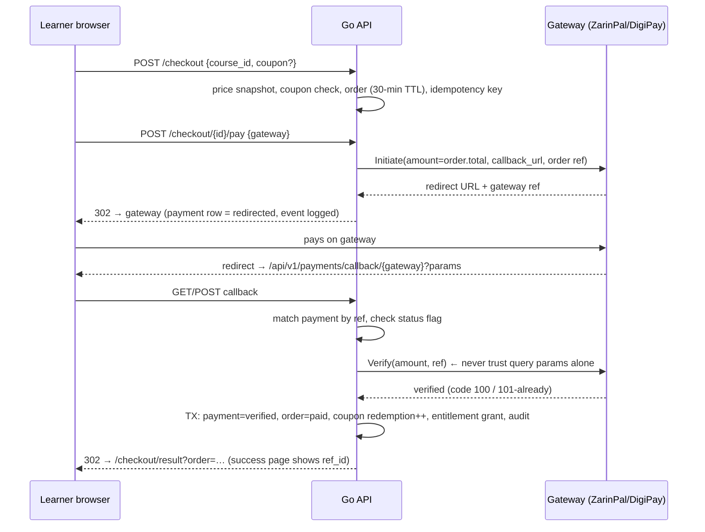

# GoLearn — Payments Design (v1 Draft 1)

Gateways: **ZarinPal** (built on the official v4 REST spec, sourced from
zarinpal.com/docs on 2026-10-30) and **DigiPay** (adapter scaffolded behind the same
port until official merchant docs are available). SnappPay is interface-ready per the
original brief and follows after these two. A **mock gateway** covers dev/tests.

## 1. Gateway port (adapter interface)

```go
// backend/internal/ports/payment.go
type PaymentGateway interface {
    Name() string
    // Initiate creates a gateway session for the order and returns the redirect URL.
    Initiate(ctx context.Context, req InitiateRequest) (InitiateResult, error)
    // Verify confirms a payment with the gateway. MUST re-check amount server-side.
    Verify(ctx context.Context, req VerifyRequest) (VerifyResult, error)
    // Refund reverses a verified payment. Returns ErrRefundUnsupported if not offered.
    Refund(ctx context.Context, req RefundRequest) (RefundResult, error)
    // ParseCallback normalizes gateway-specific callback params (browser redirect payload).
    ParseCallback(values url.Values) (CallbackData, error)
}

type InitiateRequest struct {
    OrderID     string // UUID, echoed in callback/metadata
    AmountRial  int64  // always compared to order.total_rial before AND after
    CallbackURL string // our /api/v1/payments/callback/{gateway}
    Description string
    Mobile      string
}
type InitiateResult struct { RedirectURL, GatewayRef string }
type VerifyRequest  struct { GatewayRef string; AmountRial int64; Callback url.Values }
type VerifyResult   struct { OK bool; AlreadyVerified bool; GatewayRef, CardMasked string; Raw []byte }
type RefundRequest  struct { GatewayRef string; AmountRial int64 }
```

Adapters are registered in a `GatewayRegistry` (map name → factory) built from
config; the checkout flow only knows the port. Enabled gateways come from the
`settings` table (admin can disable one without a deploy).

## 2. Payment sequence (happy path)



Idempotency: the callback handler is safe to replay — verification is guarded by the
payment row's state transition (`redirected → verified` via conditional UPDATE);
ZarinPal verify code `101` ("already verified") is treated as success.

## 3. ZarinPal adapter — official v4 spec (verified)

| Step | Spec |
|------|------|
| Request | `POST https://payment.zarinpal.com/pg/v4/payment/request.json` — `merchant_id` (36-char UUID), `amount` (Rial; `currency: IRR\|IRT` optional), `description`*, `callback_url`*, `metadata{mobile, email, order_id, auto_verify}` |
| Response | `{data:{code:100, authority, fee, fee_type}, errors:[]}` |
| Redirect | `https://payment.zarinpal.com/pg/StartPay/{authority}` |
| Callback | GET `callback_url?Authority=…&Status=OK\|NOK` — **only call verify when `Status=OK`** |
| Verify | `POST /pg/v4/payment/verify.json` — `{merchant_id, amount, authority}` → `{data:{code, ref_id, card_pan, card_hash, fee}}`; **code 100 = verified; 101 = already verified (idempotent success)**; anything else = failure |
| Refund | `POST /pg/v4/payment/reverse.json` — `{merchant_id, authority}` → `code 100 "Reversed"`. **Constraints: within 30 minutes of payment, no fee, requires server IP whitelisted in the ZarinPal panel** (else `-62`); `-63` window expired, `-61` session not successful |
| Sandbox | Base URL `https://sandbox.zarinpal.com/...`, any UUID as merchant id; sandbox authorities start with `S` |
| Auto-verify | `metadata.auto_verify=true` makes ZarinPal verify with the PSP automatically; we still send `auto_verify=false`-safe flow: we **always** verify ourselves (default off in metadata, verify call on callback), and the reconciliation job uses Inquiry/unVerified endpoints for stragglers (exact Inquiry/unVerified request shapes to be read from official docs pages at implementation time — pages identified, specs not yet fetched) |

Adapter notes: base URL from config (`sandbox` flag), timeouts 15 s + 1 retry with
jitter on network errors for verify only (verify is idempotent per code 101),
`payment_events` row for every request/response (payload JSON, secrets redacted),
`metadata.order_id = order.id` so callbacks without stored refs can still be matched.

## 4. DigiPay adapter — placeholders (TODO official docs)

Same port; concrete fields marked in code with `// TODO(digipay-docs):`:

- TODO(digipay-docs): base URLs (sandbox + prod), auth (API key vs OAuth token),
  initiate/verify endpoints, amount unit (Rial/Toman), callback parameter names,
  signature scheme, refund endpoint, idempotency semantics.
- Until then `Initiate/Verify/Refund` return `ErrNotConfigured` unless a sandbox
  base URL is set; the mock gateway keeps checkout E2E-testable regardless.

## 5. SnappPay (BNPL) — scaffold only

BNPL flows differ (installment plan creation, pre-auth/confirm). The port stays;
`snappay` adapter registers but returns `ErrNotConfigured` in v1 until the official
merchant docs are provided (per working rule: no invented API details).

## 6. Mock gateway (dev/test)

`mock` adapter + tiny HTTP app (compose profile `mockpay`) that mimics the shape of
an Iranian IPG: fixed `/start/{ref}` page with **پرداخت موفق / شکست** buttons, then
redirects to our callback with query params, and a verify endpoint that checks the
amount. Lets Playwright run register → checkout → pay → watch fully offline.

## 7. Failure, retry & reconciliation

- **Order TTL**: worker expires `awaiting_payment` orders after 30 min (coupon use not consumed).
- **Retry**: user can re-pay an unpaid order → new `payments` row (attempt history kept); one active payment per order at a time (partial unique index).
- **Reconciliation worker (every 10 min)**: payments stuck in `redirected` > 15 min → gateway inquiry/verify; verified ⇒ complete order; confirmed-failed ⇒ mark failed; unknown ⇒ `failed` + alert. Money never silently disappears: every transition writes a `payment_events` row.
- **Callback without match / amount mismatch**: logged, 400, audited, alert webhook to admin — never marked paid.
- **Double-click on pay**: idempotency key on `/pay` (order_id + gateway) returns the existing redirect.

## 8. Refunds

| Window | Path |
|--------|------|
| ≤ 30 min (ZarinPal) | automatic `gateway_reverse` via reverse.json; entitlement revoked; audit |
| > 30 min | `manual` refund record (bank transfer outside system) with reason + actor; entitlement revoked; audit |
| DigiPay/SnappPay | depends on provider capability — adapter returns `ErrRefundUnsupported` ⇒ admin uses manual path |

## 9. Security checklist (payments)

1. Amount, currency and order state verified server-side against the gateway API — callback query params alone never grant access.
2. `Status=NOK` never triggers verify (ZarinPal rule) — straight to `failed`.
3. Idempotent state transitions via conditional SQL updates; duplicate callbacks are no-ops.
4. Callback endpoint is unauthenticated by design but bound to the payment row + gateway verification; rate-limited; no user-controlled SQL/paths.
5. No card data stored beyond gateway-provided masked PAN (already masked by ZarinPal).
6. Secrets (merchant id / API keys) from env only; sandbox keys separate.
7. Admin refund flow requires `admin` role + writes audit row with before/after.
8. Payment pages are `no-store`; receipt URLs are order-scoped and ownership-checked.
