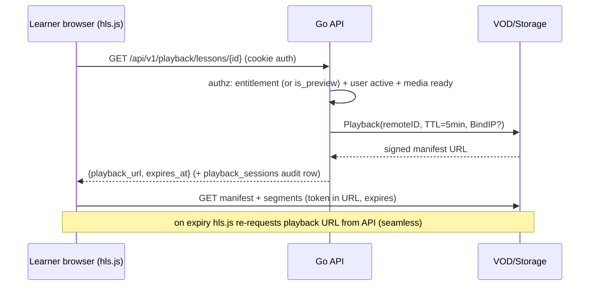

# GoLearn — Media Delivery & Protection (v1 Draft 1)

Owner decision: **managed VOD** (ArvanCloud target) for transcoding/delivery, behind a
provider-agnostic `VideoPlatform` port, with a **local adapter** so dev/tests and the
whole E2E flow run without the vendor. Hosting is undecided → S3-compatible storage
interface (MinIO locally, provider S3 in prod).

## 1. Ports

```go
// backend/internal/ports/storage.go
type Storage interface {
    PresignPut(ctx, key string, contentType string, ttl time.Duration) (url string, err error)
    Stat(ctx, key string) (ObjectInfo, error) // size, etag
    Delete(ctx, key string) error
}

// backend/internal/ports/video.go
type VideoPlatform interface {
    Name() string
    // Ingest registers an uploaded master file for transcoding.
    Ingest(ctx, master StorageRef) (remoteID string, err error)
    // Status of the transcode job.
    Status(ctx, remoteID string) (RenditionStatus, error) // processing|ready|failed(+reason)
    // Playback returns a short-lived signed playback (HLS manifest) URL.
    Playback(ctx, remoteID string, opts PlaybackOptions) (playbackURL string, expiresAt time.Time, err error)
    Delete(ctx, remoteID string) error
}
type PlaybackOptions struct { TTL time.Duration; BindIP string /* optional */ }
```

- **arvanvod adapter**: `// TODO(arvan-docs):` upload/ingest API, transcode profiles,
  token-signing scheme for playback URLs, webhook vs polling, player URL formats.
  Not invented — wired only after official docs/credentials.
- **local adapter (dev/tests)**: serves HLS fixtures from the private MinIO bucket;
  signing done by us (HMAC token in query: `exp`, `lesson`, `uid`, `nonce`), verified by
  a tiny middleware in front of the bucket route. Proves the security model end-to-end.

## 2. Upload → publish flow

```mermaid
sequenceDiagram
    participant A as Admin browser
    participant API as Go API
    participant S3 as Storage (private)
    participant W as Worker (asynq)
    participant VOD as VOD provider
    A->>API: POST /admin/media/presign {filename, size, mime, checksum}
    API-->>A: presigned PUT (10 min, one object, UUID key)
    A->>S3: PUT master.mp4 (direct, browser→storage)
    A->>API: POST /admin/media {storage_key, ...} → media_assets(uploaded)
    API->>W: enqueue ingest(media_id)
    W->>VOD: Ingest(master)
    W-->>API: status=processing (vod_remote_id stored)
    loop poll (asynq retry) or provider webhook
        W->>VOD: Status(remoteID)
    end
    W-->>API: status=ready (renditions available)
    Note over API: lesson may now reference this asset; publish allowed
```

Guards: presign only for logged-in admins; content-type/extension allowlist
(`video/mp4`, `video/quicktime`, `image/*`, `application/pdf`); max size enforced
presign-side and re-checked at registration; checksum recorded; keys are
`media/{yyyy}/{mm}/{uuid}/master.mp4` — never user-controlled strings (no traversal,
no enumeration).

## 3. Playback flow (entitlement → signed URL)



- URL TTL: 5 min default (config `PLAYBACK_TTL`, 60–900 s clamp).
- Token binds lesson + user + expiry (+ optional client IP, configurable off by
  default because mobile IPs churn); single-use nonce for issuance logs.
- Every issuance writes `playback_sessions` (user, lesson, ip, ts) — abuse analytics
  (e.g., same entitlement hammering from 50 IPs) feed rate limits/alerts.
- Issuance rate limit: e.g., 30/min per user; previews also rate-limited per IP.

## 4. Protection measures

| Threat | Measure |
|--------|---------|
| Public URLs leaked | Buckets/VOD private by default; **no public bucket, no list permission**; only short-lived signed URLs issued by the API |
| Token sharing/hotlinking | TTL ≤ 5 min; optional IP binding; referer check at provider/CDN where supported; playback-session anomaly detection |
| Enumeration | UUID keys everywhere; API never exposes storage layout; 404 vs 403 chosen to avoid oracle leaks on public routes |
| Direct storage access | Credentials server-side only (env); browser talks to storage only via presigned PUT during upload |
| Path traversal | Keys generated server-side from UUIDs; user input only in metadata |
| Expired-token stale cache | Manifest responses `Cache-Control: no-store` at our signer; segment caching is provider-side and token-scoped |
| Download/re-sharing of videos | Videos are stream-only in v1 (no download endpoints for video); attachments download only if `allow_download`, via signed URLs (15 min) |
| Watermarking | Phase 2 option: VOD-side overlay or per-user burn-in where the provider supports it; v1 relies on short tokens + audit (CSS overlay in player is trivially strippable — noted, not relied upon) |
| Leaked admin uploads | Uploads are admin-only, presigned single-object, size/type-bound |

## 5. Access rules

| Viewer | Preview lesson | Paid lesson | Attachment |
|--------|----------------|-------------|------------|
| Anonymous | ✅ signed preview URL | ❌ 401 | ❌ |
| Logged-in, not entitled | ✅ | ❌ 403 (upsell CTA) | ❌ |
| Entitled learner | ✅ | ✅ | ✅ if `allow_download` |
| Admin | ✅ | ✅ | ✅ |

## 6. Processing lifecycle & admin UX

- `media_assets.status`: `uploaded → processing → ready | failed` (worker polls
  asynq task with backoff; provider webhook accelerates when available).
- Admin media grid shows status, duration, size, storage usage; failed ingests show
  provider error and a retry button (re-enqueue); replace = upload new master,
  old `Delete`d from VOD+storage after the lesson repoints.
- Deleting a course never deletes sold entitlements; media cleanup is a separate
  audited admin action (soft-delete → purge worker after 30 days).
